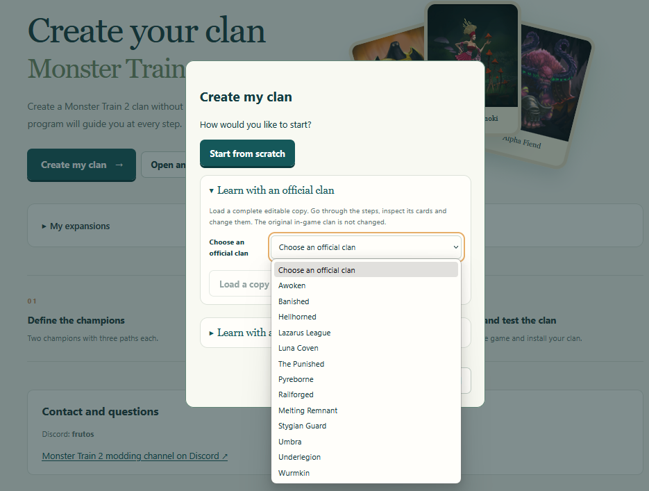
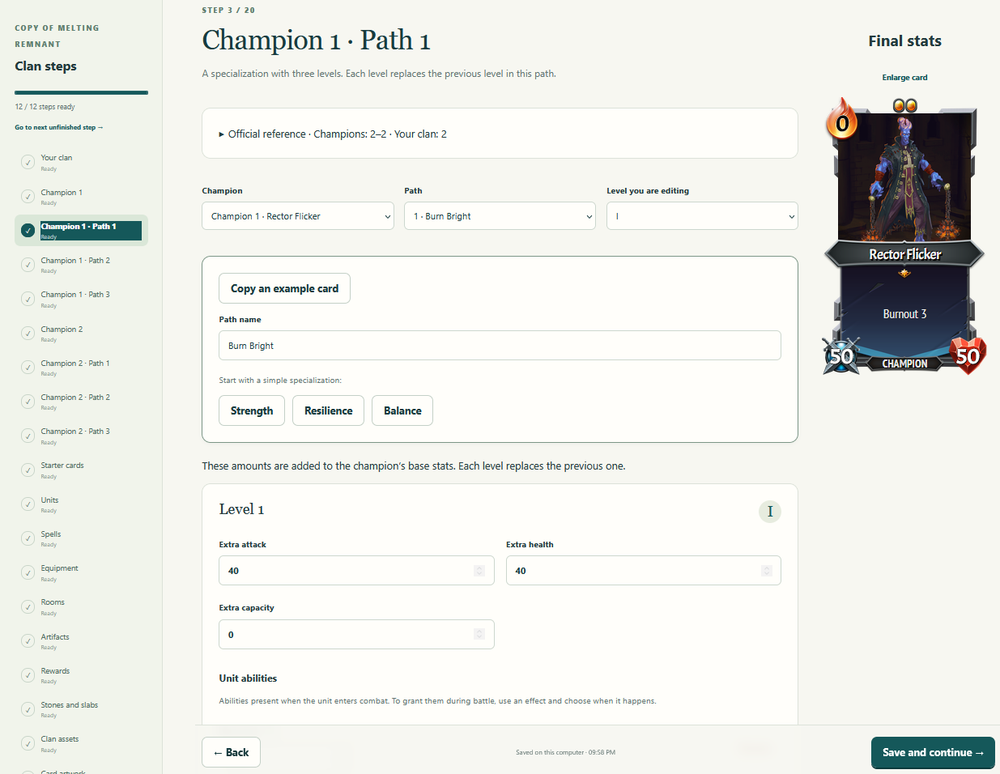
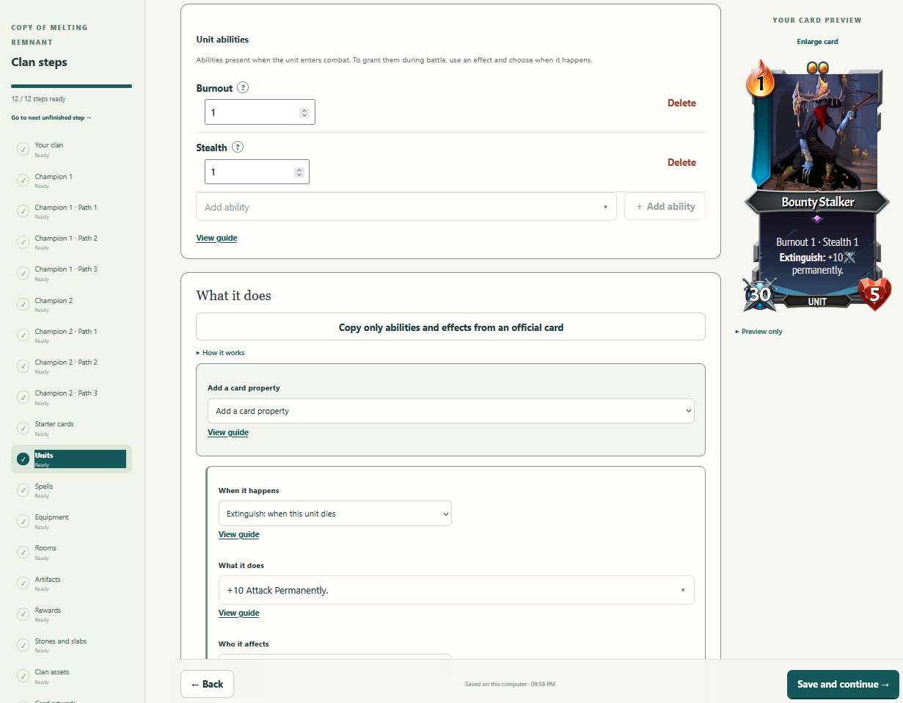
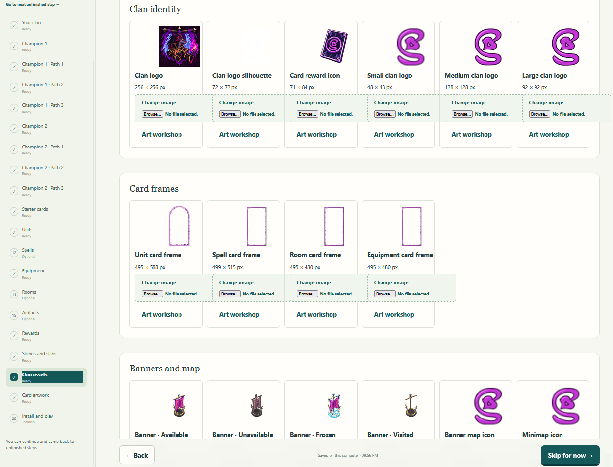
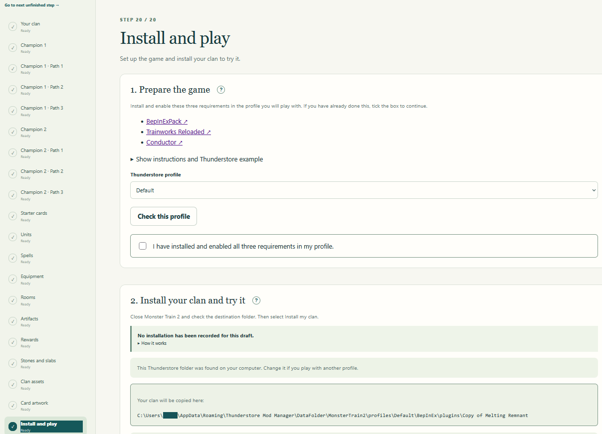
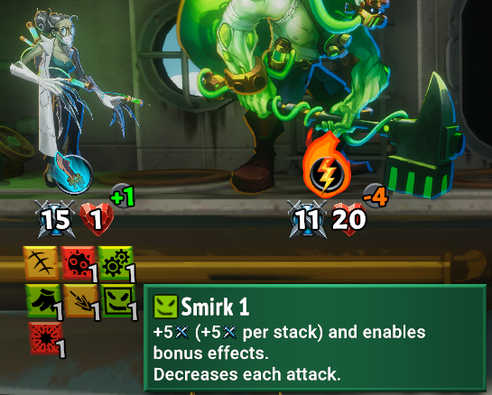

<!-- Documento generado el 2026-11-16-2047 -->

# MT2 Clan Creator

A guided Monster Train 2 clan creator for people with no programming experience. The wizard saves your clan’s rules as JSON using effects already supported by the game, Trainworks Reloaded and Conductor. When you install your clan, the creator compiles a standard loader for it.

## License

The creator’s code is available under the [MIT License](LICENSE). Monster Train 2 artwork and assets, third-party dependencies, and example mod content retain their respective rights and notices. See [catalog credits](catalog/credits).

## where the exe!?

1. Download the Windows x64 ZIP from [Releases](https://github.com/David-defrutos/mt2-clan-creator/releases).
2. Extract the whole ZIP to a folder where you can save files.
3. Open the extracted **ClanCreator** folder and double-click **start-clan-creator.cmd**. The creator opens in your browser.

Node is included. You only need the game and the .NET SDK when you’re ready to compile a clan. The current version and **Check for updates** are next to **Clan Creator** at the top of the app.

## Screenshots

**Start from scratch or learn with an example clan**

See the champion, card, artwork, and installation screens

**Customize a champion path**

**Edit unit abilities and effects**

**Set up clan artwork**

**Install your clan to try it in the game**

## Create and try a clan

Choose **Create my clan** to start from scratch, learn with an official clan, or open an editable example of The Free Company, SuccClan, or W&W Inc. Community examples are simplified versions of the original mods. Cards and paths that use custom mod code are marked when their mechanics have been simplified.

Choose **Open an existing clan** to continue a saved clan, make a separate copy of it, or open a shared **.mt2draft** file. The wizard’s first step links straight to the card collection when the clan already has cards.

Follow the wizard to define two champions with three paths each, starter cards, units, spells, equipment, rooms, artifacts, rewards, stones and slabs, clan assets, and card artwork. You can return to earlier steps, copy examples, edit or remove their effects, and undo changes.

The Windows distribution includes official examples with DLC and audited community examples. Complex official behavior can be copied without copying the name, artwork or base statistics.

Use the champion preview to compare paths and levels, and **Enlarge card** to read the full preview. The effect editor shows the timing, action, target, amount and duration where they apply.

Use **My whole clan** to see your champions, paths, starters, and reward cards with links to edit them. **Statistics** compares your clan with official clans.

The wizard marks a step ready when it has the required data. Validation messages open the affected card and field. Removed cards can be recovered immediately. Installation status compares the draft with the last installation recorded by this creator, and remembers the destination for that draft.

Use **Help** in the creator to open the reference pages for effects, timing, targets, unit abilities, card properties, and duration. **View guide** next to a field opens the corresponding page and shows which options are available for the current card. You can search, combine filters, or browse the full reference. **Back to editing** returns to the same form.

Common effects are grouped by purpose; search or **More effects** shows the full set. Importing artwork opens a preview before applying it, with separate guidance for card illustrations, combat characters and clan icons. Originals are preserved.

**New card** guides you through the type, example, basic values, effects and optional artwork. A new card in progress is saved automatically with its current step. **Save and close** pauses it; the welcome screen lets you resume the card or open the clan and return to the card later. It is included in backups but stays out of the playable clan until finished. The creator remembers the last card, path and editing level for each draft. Collections can be searched by name or effect, filtered and shown in a compact view. Path editing shows one level at a time and compares final statistics and effects across all three levels.

Warnings appear while editing and use the same checks as installation. Replacing a customized card or path requires reviewing the replacement; card names and images can be retained. Copied native effects keep any special conditions that the simple controls cannot safely change.

Use **My expansions** to choose which DLC examples to show. This is a manual preference, without checking your installation. Public packages include card illustrations and frames, including DLC card illustrations. Official combat sprites are supplied by the installed game. The package includes combat sprites for The Free Company, SuccClan and W&W Inc. examples.

**Stones and slabs** creates optional merchant upgrades for units or spells. Choose the run type, the benefit and its icon. The SuccClan example includes Curseguard Stone and Curseguard Slab.

**Clan assets** edits clan icon variants, card frames, map banners and the images shown when choosing a champion. Use **Card artwork** to review individual cards.

**Art workshop** uses four short screens: choose a style, select artwork, prepare a request, and import the result. A searchable visual library separates cards, combat characters, champion presentation, banners, frames, clan identity and in-game icons. Starting styles include card illustrations from all 13 official clans and complete English style guides for SuccClan, W&W Inc. and The Free Company. Community examples include additional reference images you can attach to the request. It prepares requests for ChatGPT or another image generator. Set a shared visual style, colours and a reference image, then describe the resource. Card illustrations can be explored as nine alternatives in a 3 × 3 sheet. Import the result, choose a cell and adjust its bounds before applying it. For final artwork or a combat character, use the chosen illustration as a reference.

The workshop covers card illustrations, combat characters, clan logos and silhouette, card reward icons, banner states, map and minimap icons, four card frames, both champions' icons, portraits and selection characters, and separate room, equipment and relic HUD icons. Frames use existing game artwork as a geometry template. Applied resources are included in the generated clan. Source images, requests and shared style stay in the draft and its portable backups. Nothing is sent to an AI service automatically. Before replacing an image, compare the current and proposed artwork. Keep the current image or apply the new one; each resource retains up to five previous versions that can be restored without reverting card rules. From an applied logo or champion portrait, preview and select related sizes and crops. Silhouettes are prepared only when the logo has real transparency.

Open **View card JSON** while editing a card to see its definition and related resources. Optional technical details in the final step show the complete generated JSON files in read-only mode. External changes do not update the wizard draft.

## Install and play

1. Open **Install and play**. The creator lists missing clan details and checks for **Monster Train 2** and the **.NET 10 SDK or newer** before you compile. Install the SDK using [Microsoft’s download page](https://dotnet.microsoft.com/en-us/download/dotnet/10.0).
2. Install and enable **BepInExPack**, **Trainworks Reloaded**, and **Conductor** in the profile you use to play. The app includes instructions for [Thunderstore Mod Manager](https://www.overwolf.com/app/thunderstore-thunderstore_mod_manager). The guide for [r2modman](https://r2modman.com/download-latest/) is in development.
3. Select your profile in the creator. If it is missing from the list, paste the path to the profile or its `BepInEx/plugins` folder. **Check this profile** is optional and reports the files and versions it finds. Tick the box once the three components are installed and enabled.
4. Close the game, check the destination shown, then select **Install my clan**. The creator compiles the loader and copies the clan into the profile. Launch that same profile with mods enabled.

The first build needs an internet connection. By default the creator downloads compiler references for Trainworks Reloaded 0.8.0 and Conductor 0.6.0 from GitHub, and BepInEx BaseLib from the BepInEx NuGet feed. It caches them for future builds. You can choose newer build references when available. Manage the mods used to play separately in your mod manager.

**Unit with Conductor abilities**

Use the in-game checklist to record what you have tried. The checklist applies to the installed version, so reinstall after changing the clan’s playable content before checking it again.

## Back up, update, or remove a clan

Use **Backups and updates** to save a portable **.mt2draft** file containing a draft and uploaded images. Restore it in a new version or on another computer; restoration creates an independent draft and does not overwrite existing work.

**Recover an earlier version** lets you save a recovery point, review changed cards and restore it. The current state is preserved before restoration. For moving multiple clans, **Save all my clans** creates one **.mt2collection** backup including uploaded artwork. Preview and select the clans to restore as independent drafts.

To update, save a backup, extract the new ZIP into a separate folder, and restore your backup there. Each extracted copy stores its own drafts under `data/creator-projects`. Keep the original `data` folder until you’ve verified the restored drafts.

On the home screen, you can delete drafts or uninstall clans that this creator installed. You can restore deleted drafts in the creator. Uninstalling preserves your draft and backs up the installed copy.

## Development

See [the development guide](docs/DEVELOPMENT-2026-11-16-2047.md) for setup, resources, tests and packaging. Windows x64 is the tested distribution; macOS and Linux packages have not been validated.

## Contact and credits

Discord: **frutos**. [Monster Train 2 modding channel](https://discord.com/channels/336546996779483136/1377778943674810368).

The creator relies on community tools, including [Trainworks Reloaded](https://github.com/Monster-Train-2-Modding-Group/Trainworks-Reloaded) and Conductor. Thanks to Amaury-Lepicard, amaurylepicard-neovision, crazyjackel, lostone-zc, TricksterGuy, and everyone who contributes to these tools. Resource provenance and notices are kept under **catalog/credits**. See the [Trainworks Reloaded](https://github.com/Monster-Train-2-Modding-Group/Trainworks-Reloaded) and [Conductor](https://github.com/Monster-Train-2-Modding-Group/Conductor) repositories for their licenses.

<!-- 2026-11-16-2047||codex-clan-editor||clan-creator/README.md||Sustituir historial e informes internos por guía pública de uso y enlace de desarrollo -->

<!-- 2026-11-16-2158||codex-clan-editor||clan-creator/README.md||Documentar ocho mejoras para uso público con inicio corto vista por senda copias y lanzador inglés -->

<!-- 2026-11-16-2340||codex-clan-editor||clan-creator/README.md||Documentar revisión guiada recuperación estados registrados y encuadre de imágenes -->

<!-- 2026-11-17-0037||codex-clan-editor||clan-creator/README.md||Documentar recuperación de contexto edición por nivel búsqueda sustituciones y ausencia de arte DLC en paquetes públicos -->

<!-- 2026-11-17-1903||codex-clan-editor||clan-creator/README.md||Documentar ocho mejoras de creación guiada contexto recuperación consejos y copias conjuntas -->

<!-- 2026-11-17-1909||codex-clan-editor||clan-creator/README.md||Retirar instrucciones del selector privado de guía pública -->

<!-- 2026-11-17-1918||codex-clan-editor||clan-creator/README.md||Documentar DLC con ilustraciones de cartas pero sin distribuir sus personajes de combate -->

<!-- 2026-11-17-1919||codex-clan-editor||clan-creator/README.md||Explicitar inclusión de personajes de los tres mods auditados -->

<!-- 2026-11-17-1958||codex-clan-editor||clan-creator/README.md||Documentar taller guiado de IA estilo compartido selección de láminas y recursos adicionales instalables -->

<!-- 2026-11-17-2002||codex-clan-editor||clan-creator/README.md||Documentar iconos adicionales y acceso al taller desde la creación de cartas -->

<!-- 2026-11-17-2247||codex-clan-editor||clan-creator/README.md||Documentar ocho mejoras de taller breve biblioteca estilos variantes historial pausas y prueba manual -->

<!-- 2026-11-19-0801||codex-clan-editor||clan-creator/README.md||Actualizar guía sobre reanudación y recuperación desde una versión anterior -->

<!-- 2026-11-19-2226||codex-clan-editor||clan-creator/README.md||Retirar las instrucciones de la opción eliminada de la portada -->

<!-- 2026-11-19-2258||codex-clan-editor||clan-creator/README.md||Explicar qué cubre la licencia MIT y dónde consultar los avisos de terceros -->

<!-- 2026-11-19-2258||codex-clan-editor||clan-creator/README.md||Explicar que las reglas se guardan en JSON y que la DLL solo usa el cargador estándar -->

<!-- 2026-11-19-2258||codex-clan-editor||clan-creator/README.md||Indicar Conductor 0.6.0 en el alcance de los efectos disponibles -->

<!-- 2026-11-21-0949||codex-clan-editor||clan-creator/README.md||Documentar la primera compilacion con descargas publicas y referencias en cache -->

<!-- 2026-11-21-0952||codex-clan-editor||clan-creator/README.md||Describir actualizaciones voluntarias y visor JSON por carta -->

<!-- 2026-11-21-1000||codex-clan-editor||clan-creator/README.md||Actualizar la guia de arranque de Windows al lanzador unico -->

<!-- 2026-11-21-1006||codex-clan-editor||clan-creator/README.md||Documentar las dos opciones de Crear mi primer clan -->

<!-- 2026-11-21-1011||codex-clan-editor||clan-creator/README.md||Documentar opciones vigentes al crear el primer clan -->

<!-- 2026-11-21-1013||codex-clan-editor||clan-creator/README.md||Actualizar el nombre del boton en la guia del repositorio -->

<!-- 2026-11-21-1021||codex-clan-editor||clan-creator/README.md||Documentar el recorrido sin revision personal y el nuevo nombre de la pantalla de instalacion -->

<!-- 2026-11-21-1030||codex-clan-editor||clan-creator/README.md||Informar de la galeria y guias completas en el taller de arte -->

<!-- 2026-11-21-1119||codex-clan-editor||clan-creator/README.md||Documentar cómo crear, abrir, duplicar y editar los clanes comunitarios -->

<!-- 2026-11-21-1218||codex-clan-editor||clan-creator/README.md||Documentar qué arte de combate se incorpora a la distribución -->

<!-- 2026-11-21-1227||codex-clan-editor||clan-creator/README.md||Actualizar los agradecimientos del repositorio -->

<!-- 2026-11-21-1229||codex-clan-editor||clan-creator/README.md||Mostrar solo los nombres de GitHub en los agradecimientos, en orden alfabético -->

<!-- 2026-11-21-1335||codex-clan-editor||clan-creator/README.md||Documentar dónde se editan las mejoras de mercader y los recursos del clan -->

<!-- 2026-11-21-1427||codex-clan-editor||clan-creator/README.md||Documentar el orden alfabético por defecto para las listas -->
<!-- 2026-11-21-1931||codex-clan-editor||clan-creator/README.md||Explicar cómo consultar la documentación y volver al asistente -->
<!-- 2026-11-21-1945||codex-clan-editor||clan-creator/README.md||Explicar dónde consultar los requisitos del perfil antes de instalar -->
<!-- 2026-11-21-2202||codex-clan-editor||clan-creator/README.md||Documentar el asistente con cinco capturas en inglés -->
<!-- 2026-11-21-2205||codex-clan-editor||clan-creator/README.md||Cambiar el título de la sección de descarga al texto solicitado -->
<!-- 2026-11-21-2208||codex-clan-editor||clan-creator/README.md||Verificar el README contra el asistente y el ZIP publicado, y actualizar las instrucciones de uso -->
<!-- 2026-11-22-0928||codex-readme-conductor||clan-creator/README.md||Añadir captura de Smirk y texto sobre soporte de habilidades de Conductor -->
<!-- 2026-11-22-0948||codex-readme-conductor||clan-creator/README.md||Mover captura tras el parrafo de referencias de compilacion y titular Unit with Conductor abilities -->
